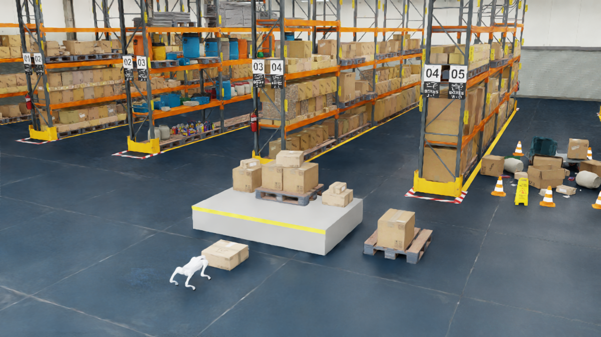
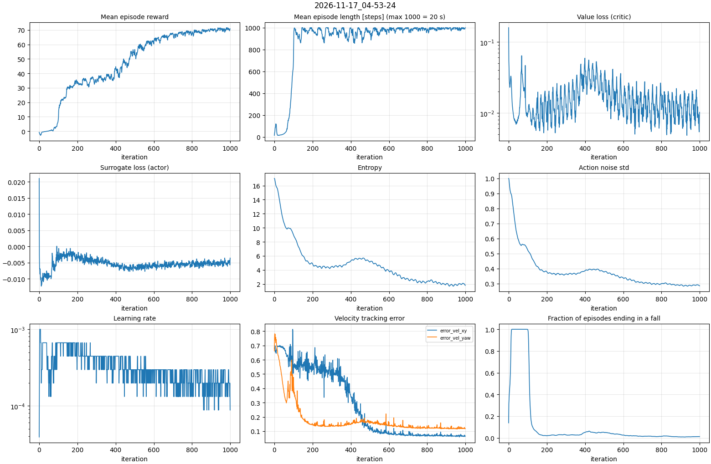
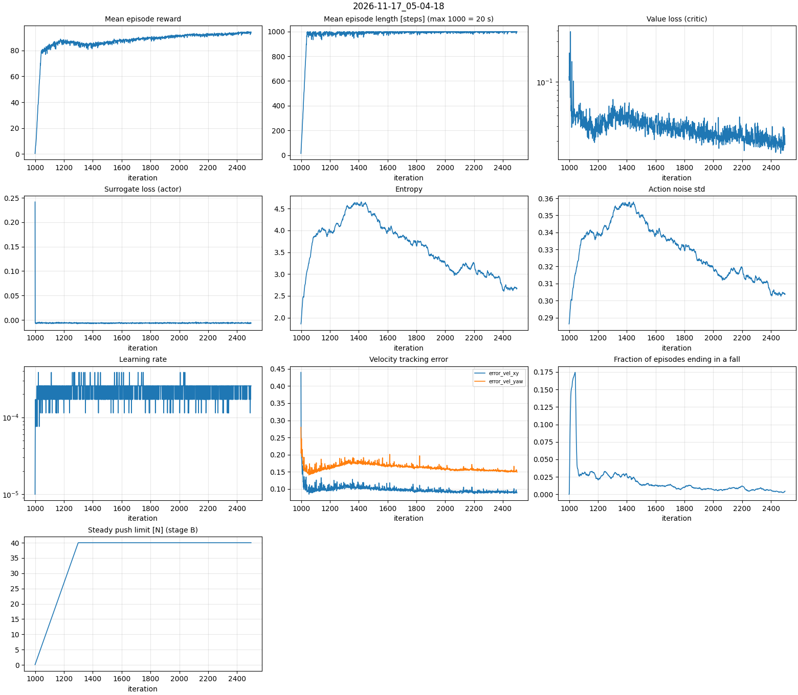

# Box-Assisted Platform Climbing for a Quadruped Robot: Project Report

This report explains how the project works, part by part, in simple words.
It is updated after each milestone. It holds only final design choices and
results, not the history of how we got there.

## 1. The task in short

A Unitree Go2 robot dog in a warehouse must get onto a 0.5 m staging platform.
That is too high to jump onto directly. A 0.25 m cardboard delivery box sits
nearby. The robot:

1. **Pushes** the box until it touches the platform.
2. **Jumps** from the ground onto the box.
3. **Jumps** from the box onto the platform.

Each step starts where the previous one ended, so a small mistake early on
(for example, the box left slightly crooked) can make a later jump fail.

## 2. System overview

| Layer | What it does | Method |
| --- | --- | --- |
| Sequencer | Picks the next skill (push again, reposition, jump) | Value function V(s) built from logged success rates |
| Push skill | Plans walking commands that move the box to the platform | MPPI (sampling-based MPC) on a simple planar model |
| Jump skills | Plan and execute each jump | Trajectory optimization (CasADi) → inverse kinematics → PPO tracking policy (compared with RL from scratch) |
| Base locomotion | Turns velocity commands (vx, vy, ωz) into joint targets | PPO velocity-tracking policy |
| Simulator | Physics for robot, box and platform | Isaac Lab |

## 3. Repository layout

| Path | Contents |
| --- | --- |
| `CLAUDE.md` | Team rules (for people and their AI agents) |
| `README.md` | Entry point; how to view the simulation (gui / headless / stream) |
| `pyproject.toml` | Makes `go2_box_climb` an installable Python package |
| `proposal/` | The project proposal (PDF) |
| `docs/PROJECT_REPORT.md` | This report |
| `docs/installation.md` | How to install the exact same Isaac Sim / Isaac Lab setup |
| `docs/figures/` | Plots and images used in this report |
| `env/isaaclab-requirements.lock.txt` | Exact versions of every Python package |
| `go2_box_climb/common/` | **Shared contracts** (Isaac-free): robot settings, scene geometry, state, skill interface, file formats |
| `go2_box_climb/utils/launch.py` | Starts Isaac Sim in `headless`, `gui` or `stream` mode; `--video` keeps a camera to record from, also headless |
| `go2_box_climb/utils/video.py` | `VideoRecorder`: saves what the camera sees as an MP4 in `videos/` (the `--video` option) |
| `go2_box_climb/utils/runs.py` | Where training runs are saved (`logs/rsl_rl/...` at the repository root) |
| `go2_box_climb/utils/training_plots.py` | Draws training curves (PNG) from a run's TensorBoard log; redrawn live during training |
| `go2_box_climb/assets/` | Robot, box and platform configurations; `warehouse.py` holds the warehouse look (delivery box, staging platform, decorations, building) and `spawners.py` the "cuboid physics, detailed look" spawner |
| `go2_box_climb/envs/scene/` | The shared scenes, picked with `--scene`: `basic` (plain floor; jump training) and `warehouse` (final test world) |
| `go2_box_climb/envs/locomotion/` | Walking training task: environment (stage A walking, stage B + steady push), PPO settings, push force and its ramp |
| `go2_box_climb/envs/jump_from_tracking/` | Training env of the TO-guided jump policy (basic scene) _(empty for now)_ |
| `go2_box_climb/envs/jump_from_scratch/` | Training env of the from-scratch jump policy (basic scene) _(empty for now)_ |
| `go2_box_climb/skills/locomotion/` | Runs the walking policy without the simulator: `WalkingPolicy` (command + state → joint actions), `WalkSkill` |
| `go2_box_climb/skills/push_mppi/` | MPPI pusher _(empty for now)_ |
| `go2_box_climb/skills/jump/` | Jump skills: `to/` (trajectory optimization + IK, run once offline → reference files), `jump_from_tracking/`, `jump_from_scratch/` (run the trained jump policies) _(empty for now)_ |
| `go2_box_climb/sequencer/` | Value-based sequencer _(empty for now)_ |
| `go2_box_climb/eval/` | Trial runner and logging for the studies, including the one jump evaluation that compares both jump policies _(empty for now)_ |
| `scripts/` | Runnable programs: `view_scene.py`; `plot_training.py` (plot or compare runs); `locomotion/train.py`, `play.py`, `eval.py`, `play_keyboard.py` (walking policy) |
| `tests/` | Fast tests that do not need the simulator (`pytest`) |
| `policies/` | Released policies — the only model files kept in git. `walking/policy.pt` (+ `README.md` training note) is the walking policy |
| `references/` | Jump reference trajectories from trajectory optimization (`jump_ground_to_box.npz`, `jump_box_to_platform.npz`), computed once offline; committed like the policies _(empty for now)_ |
| `logs/`, `outputs/`, `videos/` | Training/run output and recorded videos — ignored by git, never pushed |

## 4. Milestones

### 4.0 Project foundation: package, shared contracts, viewing modes

**What it is.** The base every teammate builds on: one Python package
(`go2_box_climb`), a set of shared "contracts", and one way to start Isaac Sim.

**The package.** All code lives in the `go2_box_climb` package, installed with
`pip install -e .`. "Editable" (`-e`) means Python uses the files in the repo
directly, so edits take effect without reinstalling.

**One robot model.** Every part takes robot geometry from the same Go2 USD file
the simulator uses, through `common/robot_geometry.py`, so all parts agree. It reads
the file with `pxr`, the USD library, which does not start Isaac Sim (that takes
about a minute and needs a GPU), so planning code and its tests stay fast.
Code that needs the running simulator (`assets/`, `envs/`, `utils/launch.py`)
may only be imported after the simulator is launched (an Isaac Lab requirement).

**Shared contracts (`go2_box_climb/common/`).** These are the agreements that
let separately built parts fit together:

| File | What it fixes |
| --- | --- |
| `constants.py` | Robot settings and scene geometry (tables below); the jump rules shared by both jump policies (failure and success limits, start and box-placement ranges) |
| `state.py` | `TaskState`: robot base pose/velocity, 12 joint angles/velocities, box pose/velocity, time — plain numpy |
| `skill.py` | `Skill` interface: `reset(state)`, `act(state)` → 12 actions, `status(state)` → RUNNING / SUCCESS / FAILURE. The sequencer only uses this, so jump variants are interchangeable |
| `formats.py` | `JumpReference` (TO output → jump policy input, `.npz`) and the trial-log CSV columns used by the studies and the sequencer |
| `robot_geometry.py` | `go2_geometry()`: link lengths, joint offsets, foot radius and head position, read from the simulator's own Go2 USD (downloaded once to `~/.cache/go2_box_climb/`) |

**Robot contract** (same as Isaac Lab's Go2 locomotion setup):

| Setting | Value | Meaning |
| --- | --- | --- |
| Physics step | 0.005 s (200 Hz) | How often the physics is updated |
| Decimation | 4 | Physics steps per policy decision |
| Policy step | 0.02 s (50 Hz) | How often a policy outputs a new action |
| Joint order | FL, FR, RL, RR hips → thighs → calves | Isaac Lab groups joints **by type**, not by leg |
| Default pose | hips ±0.1, thighs 0.8 (front) / 1.0 (rear), calves −1.5 rad | Standing pose |
| Action | `q_target = default_pose + 0.25 · a` | Every policy outputs 12 numbers `a` |
| PD gains | Kp = 25 N·m/rad, Kd = 0.5 N·m·s/rad | `torque = Kp (q_target − q) − Kd q̇` |
| Motor limits | 23.5 N·m, 30 rad/s | DC-motor model clips the torque |
| Quaternions | (x, y, z, w) | Isaac Lab 3.0 convention |

Why one contract: in the full task the walking policy and both jump policies
control the same robot one after another. If one of them were trained with
different gains or a different action scale, it would fail when chained.

**Three viewing modes.** Every script takes `--mode headless | gui | stream`
(see the README). `stream` uses WebRTC on the local network: the sim runs
without a window and you watch from another computer with NVIDIA's streaming
client, connecting to the IP address the script prints. The IP is detected
automatically, so the same command works on every teammate's machine.

**Recording videos (`--video`).** Watching live needs a screen or open network
ports, which a cluster often does not give you. So the playback scripts
(`scripts/locomotion/play.py` and `play_keyboard.py` for now) also take
`--video`: they save what the camera sees as an MP4 in `videos/` (ignored by
git). It works in every mode, also `--mode headless`. There the camera is
rendered off screen (no window is opened) and you copy the file to your laptop.
This is how we check a policy's movements while tuning its rewards.
- One frame is saved per policy step (50 per second), so the video plays at
  real speed. In `play_keyboard.py` the camera follows the robot.
- The frames come from Isaac Lab's own viewport capture: `render_rgb_array()`
  of the Kit visualizer, Isaac Lab's built-in viewer.
- The file is written with OpenCV, which is already installed. Isaac Lab's own
  recorder needs the `moviepy` package, which is not in our lock file, so using
  it would change everyone's install.
- Any script can record with three lines, using `VideoRecorder` from
  `utils/video.py`: create it, call `capture()` after every step, and `close()`
  at the end. If a script stops early (Ctrl+C), `close_app` still finishes the
  file.

```bash
python scripts/locomotion/play_keyboard.py --mode headless --video --auto "0.3,0,0,8,0.27;0,0,0,2"
python scripts/locomotion/play.py --stage a --mode headless --video --duration 10 --checkpoint logs/rsl_rl/go2_walk/<run>/model_999.pt
```

**How to test.** `python -m pytest -q` checks the contracts (6 tests).
`tests/test_video.py` checks the video recorder without the simulator: it writes
a short MP4 and reads it back (2 tests).

### 4.1 Isaac Lab scenes (basic and warehouse)

**What it is.** The world the robot lives in. There are two scenes with the
**same task geometry and physics**, picked by name with `--scene`:

| Scene | What you see | Used for |
| --- | --- | --- |
| `basic` | Plain grid floor, an orange block (box) and a gray block (platform) | Quick tests; a starting point for training scenes |
| `warehouse` | The same objects drawn as a cardboard delivery box and a concrete staging platform, inside NVIDIA's full warehouse (racks of boxes, pallets, forklift, signs) | **Final test, deployment of the trained policies, demos and videos** |

Training will use its own light scenes (for example a flat floor for walking, and
only the box and platform for jumping). The policies never see the warehouse,
because they observe joint states and object positions, not camera images. So a
policy trained in a light scene behaves the same in the warehouse.

**Layout** (both scenes, in the environment's own frame; x points forward, z up):

| Object | Size (x × y × z) | Position | Physics |
| --- | --- | --- | --- |
| Ground | infinite plane | z = 0 | friction 1.0 |
| Go2 | — | base starts at (0, 0, 0.4), facing +x | 12 joints, PD control |
| Box | 0.6 × 0.6 × 0.25 m, 5 kg | center (1.0, 0, 0.125) | movable rigid body, friction 0.5 |
| Platform | 2.0 × 3.0 × 0.5 m | front face at x = 2.0 | static (never moves), friction 1.0 |

The push goal is the box flush against the platform: box center at
(1.7, 0, 0.125). The box starts 0.7 m from that goal. The first 1.0 m of the
platform behind its front edge is always kept free of obstacles: this is the
landing zone of the last jump (`PLATFORM_CLEAR_DEPTH`).

All these numbers live in `go2_box_climb/common/constants.py`.

**Design choices.**
- *Two equal 0.25 m steps* (ground → box top → platform top): each jump has the
  same height, so the jump skills solve two similar problems. This is the
  proposal's 0.2 m / 0.4 m idea, made slightly bigger and more realistic for a
  warehouse. (Real truck loading docks are about 1.2 m high, which the Go2 cannot
  reach, so we use a lower "staging platform".)
- *Box 0.6 × 0.6 m:* the Go2's feet stand about 0.39 m apart front to back, so
  this leaves room for all four feet to land on the box. The cardboard model is
  0.5 × 0.5 m and is stretched to 0.6 × 0.6 m.
- *Box 5 kg, friction 0.5* (a parcel on concrete): about 25 N is needed to slide
  it (0.5 × 5 kg × 9.81 m/s²), which the Go2 can push. The values will be
  confirmed by driving the robot with the keyboard.
- *Platform 2.0 m deep:* room for a clear 1.0 m landing zone at the front plus
  pallets and boxes at the back.
- *Platform as a static collider:* it has a collision shape but no rigid body, so
  physics treats it as fixed ground.
- *Contact sensor on all robot bodies:* needed later for foot contacts and fall
  detection.

**How the warehouse scene is built.**
- *Simple physics, detailed look.* Everything the robot touches is still an exact
  block underneath. The box is an invisible cuboid (the physics body) with the
  cardboard 3D model attached as a child that is only drawn, never collides and
  adds no mass (`assets/spawners.py`). Two reasons: the MPPI and trajectory
  optimization models assume clean box shapes, and the cardboard model's origin
  is at its bottom while our contract says the box position is its **center**.
- *Staging platform:* the same block as in `basic`, with a concrete color and a
  yellow safety band on its front face (the band is visual only).
- *Decorations:* a pallet with stacked boxes at the back of the platform, boxes in
  its back corners, and a loaded pallet on the floor beside it. They are solid,
  so the robot cannot walk through them, and they stay out of the landing zone
  and out of the robot's path.
- *The building* (`full_warehouse.usd`) is loaded once for the whole world and
  rotated so the robot stands on the open floor looking down a rack aisle, with
  the racks about 3 m behind the platform. It is **visual only**: its own
  colliders are switched off, and the robot walks on an invisible ground plane
  with the contract's friction (1.0). The building surrounds one environment, so
  the warehouse scene runs with `--num_envs 1`.
- *3D models* come from NVIDIA's Isaac Sim asset library ("Simple_Warehouse").
  They are downloaded on first use (about 1,800 files) and cached in
  `/tmp/https/...`, so the first start takes several minutes and later starts are
  fast (until the computer is restarted and `/tmp` is emptied).

**Check.** Running each scene for 3 s with the robot holding its standing pose:
- the simulator's joint order matches the contract;
- the robot settles at about 0.28 m base height and the box stays exactly in place;
- both scenes give **identical** robot and box positions, so the warehouse's
  invisible ground and look-only models do not change the physics;
- the box mass is 5 kg (the cardboard model adds none) and no collider of the
  building is active.


*The warehouse scene: Go2 (start), the delivery box, and the staging platform with
its yellow safety band and pallets, in front of a rack aisle.*



**How to run.**
```bash
python scripts/view_scene.py --scene warehouse --mode gui      # warehouse, Isaac Sim window
python scripts/view_scene.py --scene warehouse --mode stream   # warehouse, watch from another computer
python scripts/view_scene.py --mode gui                        # basic scene (default)
python scripts/view_scene.py --mode headless --duration 5      # no window, prints positions
python scripts/view_scene.py --num_envs 4                      # several copies (basic scene only)
```

**Code.**
- `go2_box_climb/assets/objects.py`: box and platform for the basic scene.
- `go2_box_climb/assets/warehouse.py`: delivery box, staging platform, safety
  band, decorations, building placement.
- `go2_box_climb/assets/spawners.py`: the "cuboid physics, detailed look" spawner.
- `go2_box_climb/envs/scene/box_climb_scene.py`: the `basic` scene.
- `go2_box_climb/envs/scene/warehouse_scene.py`: the `warehouse` scene.
- `go2_box_climb/envs/scene/__init__.py`: the list of scene names and
  `get_scene_cfg_class(name)`. To add a scene, add a name here.
- `scripts/view_scene.py`: opens any scene.

### 4.2 Walking policy (PPO velocity tracker)

**What it does.** Turns a command (forward speed vx, sideways speed vy, turn rate
ωz, body height h) into 12 joint targets at 50 Hz. MPPI drives it to push the box;
the sequencer uses it to walk and stand before the jumps. Body height is a command
so the push skill can lower the robot: at h = 0.27 m the head (center about 0.21 m)
meets the box face, below its 0.25 m top. Normal walking uses h = 0.32 m.

**Observations (49).** All in the robot's body frame, no scaling:

| Inputs | Size |
| --- | --- |
| base linear velocity [m/s], angular velocity [rad/s] | 3 + 3 |
| gravity direction (tilt) | 3 |
| command vx, vy [m/s], ωz [rad/s] | 3 |
| joint angles − default pose [rad], joint velocities [rad/s] | 12 + 12 |
| previous action | 12 |
| body-height command, as (h − 0.32 m) × 20 | 1 |

**Actions (12).** Joint targets = default pose + 0.25 × action, tracked by the
PD controller (Kp 25, Kd 0.5, 200 Hz). All robot settings come from `common/`.

**Rewards.** Tracking rewards use exp(−error²/std²); the others are penalties.

| Term | Weight | Purpose |
| --- | --- | --- |
| speed (vx, vy) / turn rate tracking, std 0.25 | +2.0 / +1.0 | follow the command |
| body height tracking, std 0.04 m | +1.5 | follow h |
| trot: diagonal feet in sync | +1.0 | clean trot |
| air time (0.3 s steps while moving, feet down when standing) | +0.5 | real steps, no shuffling |
| foot clearance (foot center 0.08 m while swinging) | +0.7 | lift the feet |
| foot slip, hip angle away from default | −0.25, −0.3 | no sliding, legs under the body |
| standing: joints away from the standing pose for h | −0.5 | stand still at any height |
| standing: feet off the ground (per foot) | −1.0 | feet planted |
| vertical speed², roll/pitch rate², tilt | −2.0, −0.05, −2.5 | steady body |
| action change², joint acceleration², torque² | −0.02, −2.5e-7, −2e-4 | smooth, low effort |

The standing pose for a height h is computed with leg geometry from the robot model
(`standing_pose.py`), so standing still does not fight the height command.

**Episode end.** Trunk or head touches the ground, or 20 s.

**Commands during training.** vx ±1 m/s, vy ±0.6 m/s, ωz ±1 rad/s; 20% "stand
still"; h from 0.25 to 0.34 m (30% exactly 0.32); new commands every 5 s.

**Randomization.** Foot friction 0.4–1.25; body mass ±25%; center of mass ±5 cm;
random start pose and velocity; shoves (±0.5 m/s every 10–15 s); a steady push on
the head, up to ±40 N forward/back and ±15 N sideways, re-drawn every 2–5 s (the box
pushing back).

**Training.** PPO (rsl_rl), 4096 robots on flat ground, 24 steps per robot per
update, actor and critic MLPs 512-256-128 (ELU), learning rate 1e-3 (adaptive,
target KL 0.01), γ 0.99, λ 0.95, clip 0.2, entropy 0.01, 5 epochs × 4 mini-batches.
Two stages:

- **Stage A** (1000 iterations, about 9 min on an RTX PRO 5000): walking, without
  the height command, the steady push and the feet-planted term (its standing pose
  is the default pose); commands every 10 s, 10% "stand still".
- **Stage B** (1500 iterations, about 15 min): continues from stage A with
  everything above. The new height input starts with zero weight, so stage B
  starts from stage A's behavior.




**Results** (`scripts/locomotion/eval.py --stage b`, 64 robots, 6 s per case, no
pushes):

| Command | Actual | Body height |
| --- | --- | --- |
| forward 0.3 / 0.6 / 1.0 m/s | 0.30 / 0.61 / 1.00 m/s | 0.32 m |
| backward 0.5 m/s | 0.49 m/s | 0.32 m |
| sideways 0.4 m/s | 0.40 m/s | 0.32 m |
| turn 0.8 rad/s (at 0.3 m/s) | 0.79 rad/s | 0.32 m |
| forward 0.3 m/s at h 0.27 m | 0.30 m/s | 0.27 m |

- No falls. Trot with low steps (about 2 cm foot clearance): on a flat floor a
  higher swing brings no benefit, and low steps keep more feet on the ground while
  pushing.
- Standing still, from rest or right after walking, at 0.25–0.32 m: feet planted
  (off the ground ≤0.1% of the time), joints still.

**Released policy.** `policies/walking/policy.pt` (training note in
`policies/walking/README.md`), the default of `WalkingPolicy` / `WalkSkill`.
Training checkpoints (not in git): stage A
`logs/rsl_rl/go2_walk/2026-11-17_04-53-24/model_999.pt`, stage B
`logs/rsl_rl/go2_walk_push/2026-11-17_05-04-18/model_2498.pt`.

**How to run.**
```bash
python scripts/locomotion/train.py --stage a --mode headless
python scripts/locomotion/train.py --stage b --mode headless --load logs/rsl_rl/go2_walk/<run>/model_999.pt
python scripts/locomotion/eval.py --stage b --checkpoint <run>/model_2498.pt   # speed, gait, standing
python scripts/locomotion/play.py --stage b --mode gui --checkpoint <run>/model_2498.pt
python scripts/locomotion/play_keyboard.py --scene warehouse --mode gui        # drive the released policy
python scripts/plot_training.py <run>                                          # training curves
```

**Code.** `go2_box_climb/envs/locomotion/` (environment, rewards, PPO settings,
standing pose), `go2_box_climb/skills/locomotion/` (wrapper and skill, no
simulator needed), `scripts/locomotion/`.


### 4.3 Jump trajectory optimization and inverse kinematics
_Not started._

### 4.4 Jump policies (TO-guided RL and RL from scratch)
_Not started._

### 4.5 Push skill (MPPI)
_Not started._

### 4.6 Full chain: push → jump → jump
_Not started._

### 4.7 Sequencer
_Not started._

### 4.8 Evaluation tools
_Not started._

## 5. Studies and results

### 5.1 Box placement study
_Not started._

### 5.2 Sequencer vs. fixed order
_Not started._

### 5.3 TO-guided RL vs. RL from scratch
_Not started._
