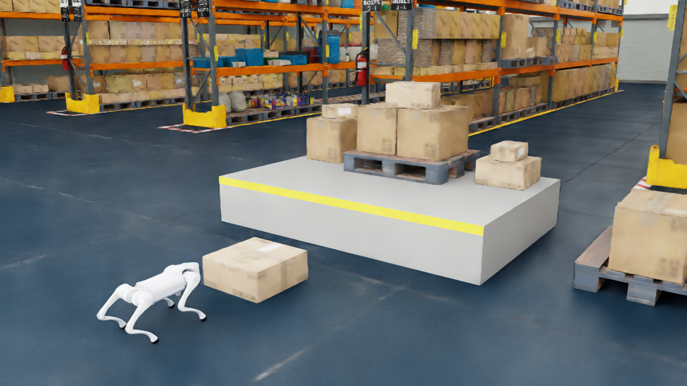
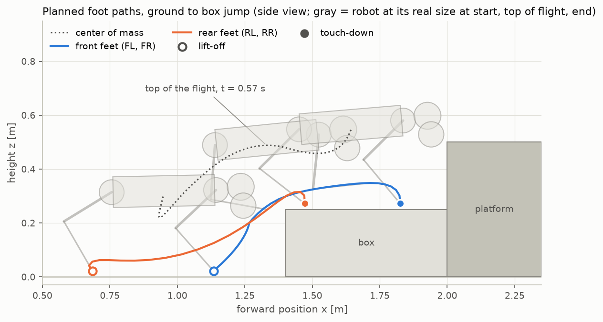
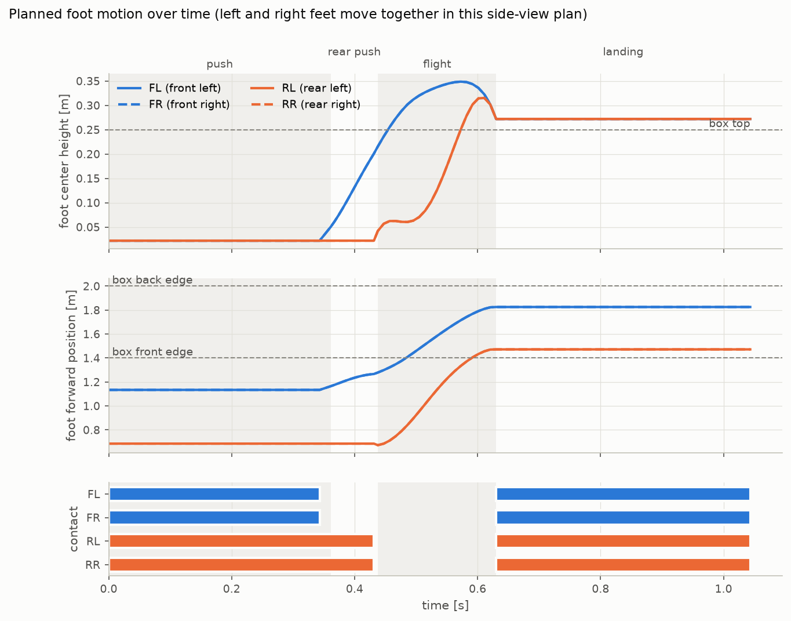
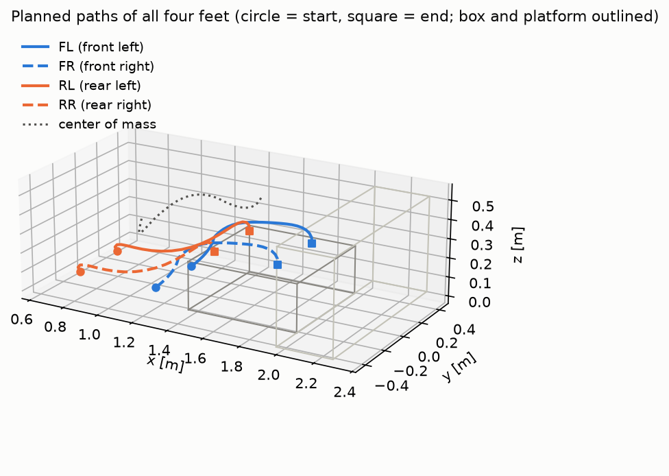
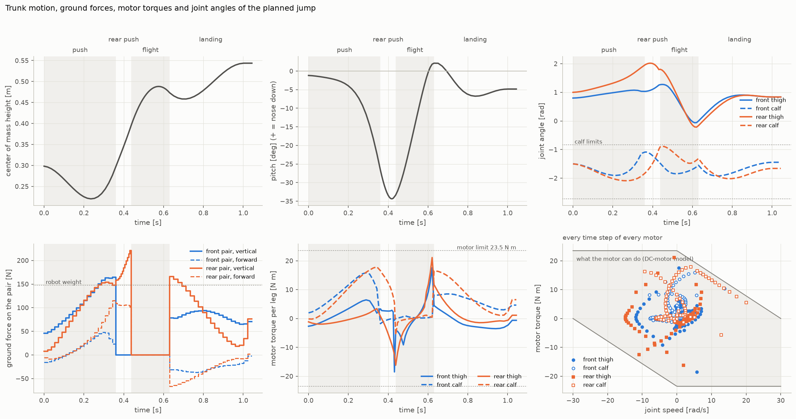
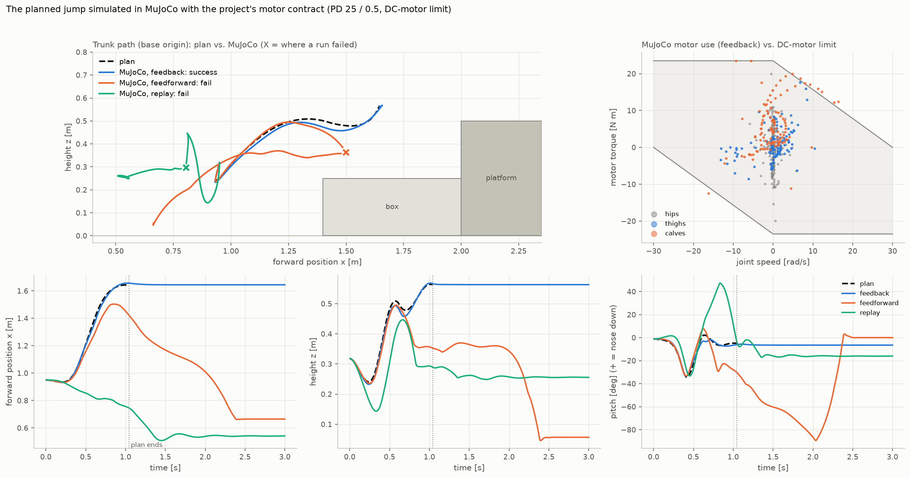
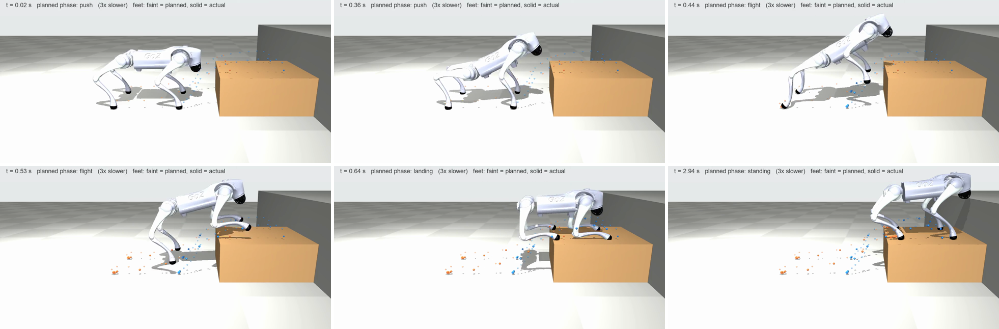

# Box-Assisted Platform Climbing for a Quadruped Robot: Project Report

This report explains how the project works, part by part, in simple words.
It is updated after each milestone. It holds only final design choices and
results, not the history of how we got there.

## 1. The task in short

A Unitree Go2 robot dog in a warehouse must get onto a 0.5 m staging platform.
That is too high to jump onto directly. A 0.25 m cardboard delivery box sits
nearby. The robot:

1. **Pushes** the box until it touches the platform.
2. **Jumps** from the ground onto the box.
3. **Jumps** from the box onto the platform.

Each step starts where the previous one ended, so a small mistake early on
(for example, the box left slightly crooked) can make a later jump fail.

## 2. System overview

| Layer | What it does | Method |
| --- | --- | --- |
| Sequencer | Picks the next skill (push again, reposition, jump) | Value function V(s) built from logged success rates |
| Push skill | Plans walking commands that move the box to the platform | MPPI (sampling-based MPC) on a simple planar model |
| Jump skills | Plan and execute each jump | Trajectory optimization (CasADi) → inverse kinematics → PPO tracking policy (compared with RL from scratch) |
| Base locomotion | Turns velocity commands (vx, vy, ωz) into joint targets | PPO velocity-tracking policy |
| Simulator | Physics for robot, box and platform | Isaac Lab |

## 3. Repository layout

| Path | Contents |
| --- | --- |
| `CLAUDE.md` | Team rules (for people and their AI agents) |
| `README.md` | Entry point; how to view the simulation (gui / headless / stream) |
| `pyproject.toml` | Makes `go2_box_climb` an installable Python package |
| `proposal/` | The project proposal (PDF) |
| `docs/PROJECT_REPORT.md` | This report |
| `docs/installation.md` | How to install the exact same Isaac Sim / Isaac Lab setup |
| `docs/figures/` | Plots and images used in this report |
| `env/isaaclab-requirements.lock.txt` | Exact versions of every Python package |
| `go2_box_climb/common/` | **Shared contracts** (Isaac-free): robot settings, scene geometry, state, skill interface, file formats |
| `go2_box_climb/utils/launch.py` | Starts Isaac Sim in `headless`, `gui` or `stream` mode |
| `go2_box_climb/utils/runs.py` | Where training runs are saved (`logs/rsl_rl/...` at the repository root) |
| `go2_box_climb/utils/training_plots.py` | Draws training curves (PNG) from a run's TensorBoard log; redrawn live during training |
| `go2_box_climb/assets/` | Robot, box and platform configurations; `warehouse.py` holds the warehouse look (delivery box, staging platform, decorations, building) and `spawners.py` the "cuboid physics, detailed look" spawner |
| `go2_box_climb/envs/scene/` | The shared scenes, picked with `--scene`: `basic` (plain floor; jump training) and `warehouse` (final test world) |
| `go2_box_climb/envs/locomotion/` | Walking training task: environment (stage A walking, stage B + steady push), PPO settings, push force and its ramp |
| `go2_box_climb/envs/jump_from_tracking/` | Training env of the TO-guided jump policy (basic scene) _(empty for now)_ |
| `go2_box_climb/envs/jump_from_scratch/` | Training env of the from-scratch jump policy (basic scene) _(empty for now)_ |
| `go2_box_climb/skills/locomotion/` | Runs the walking policy without the simulator: `WalkingPolicy` (command + state → joint actions), `WalkSkill` |
| `go2_box_climb/skills/push_mppi/` | MPPI pusher _(empty for now)_ |
| `go2_box_climb/skills/jump/to/` | Jump trajectory optimization (side-view model, CasADi + IPOPT), an independent physics check, a MuJoCo check (Go2 built from the same USD), conversion to `JumpReference`, plots and animation; runs on a laptop, no Isaac Sim needed |
| `go2_box_climb/skills/jump/` | Jump skills: `jump_from_tracking/`, `jump_from_scratch/` (run the trained jump policies) _(empty for now)_ |
| `go2_box_climb/sequencer/` | Value-based sequencer _(empty for now)_ |
| `go2_box_climb/eval/` | Trial runner and logging for the studies, including the one jump evaluation that compares both jump policies _(empty for now)_ |
| `scripts/` | Runnable programs: `view_scene.py`; `plot_training.py` (plot or compare runs); `locomotion/train.py`, `play.py`, `eval.py`, `play_keyboard.py` (walking policy); `jump/plan_jump.py` (plan a jump, save the reference and plots); `jump/replay_mujoco.py` (draw the plan with the real Go2, no physics); `jump/simulate_mujoco.py` (run the plan in MuJoCo) |
| `tests/` | Fast tests that do not need the simulator (`pytest`) |
| `policies/` | Released policies — the only model files kept in git. `walking/policy.pt` (+ `README.md` training note) is the walking policy |
| `references/` | Jump reference trajectories from trajectory optimization (`jump_ground_to_box.npz`, `jump_box_to_platform.npz`), computed once offline; committed like the policies. `jump_ground_to_box.npz` is released; `jump_box_to_platform.npz` is not made yet |
| `logs/`, `outputs/` | Training/run output — ignored by git, never pushed |

## 4. Milestones

### 4.0 Project foundation: package, shared contracts, viewing modes

**What it is.** The base every teammate builds on: one Python package
(`go2_box_climb`), a set of shared "contracts", and one way to start Isaac Sim.

**The package.** All code lives in the `go2_box_climb` package, installed with
`pip install -e .`. "Editable" (`-e`) means Python uses the files in the repo
directly, so edits take effect without reinstalling.

**One robot model.** Every part takes robot geometry from the same Go2 USD file
the simulator uses, through `common/robot_geometry.py`, so all parts agree. It reads
the file with `pxr`, the USD library, which does not start Isaac Sim (that takes
about a minute and needs a GPU), so planning code and its tests stay fast.
Code that needs the running simulator (`assets/`, `envs/`, `utils/launch.py`)
may only be imported after the simulator is launched (an Isaac Lab requirement).

**Shared contracts (`go2_box_climb/common/`).** These are the agreements that
let separately built parts fit together:

| File | What it fixes |
| --- | --- |
| `constants.py` | Robot settings and scene geometry (tables below); the jump rules shared by both jump policies (failure and success limits, start and box-placement ranges) |
| `state.py` | `TaskState`: robot base pose/velocity, 12 joint angles/velocities, box pose/velocity, time — plain numpy |
| `skill.py` | `Skill` interface: `reset(state)`, `act(state)` → 12 actions, `status(state)` → RUNNING / SUCCESS / FAILURE. The sequencer only uses this, so jump variants are interchangeable |
| `formats.py` | `JumpReference` (TO output → jump policy input, `.npz`) and the trial-log CSV columns used by the studies and the sequencer |
| `robot_geometry.py` | `go2_geometry()`: link lengths, joint offsets, foot radius and head position, read from the simulator's own Go2 USD (downloaded once to `~/.cache/go2_box_climb/`) |

**Robot contract** (same as Isaac Lab's Go2 locomotion setup):

| Setting | Value | Meaning |
| --- | --- | --- |
| Physics step | 0.005 s (200 Hz) | How often the physics is updated |
| Decimation | 4 | Physics steps per policy decision |
| Policy step | 0.02 s (50 Hz) | How often a policy outputs a new action |
| Joint order | FL, FR, RL, RR hips → thighs → calves | Isaac Lab groups joints **by type**, not by leg |
| Default pose | hips ±0.1, thighs 0.8 (front) / 1.0 (rear), calves −1.5 rad | Standing pose |
| Action | `q_target = default_pose + 0.25 · a` | Every policy outputs 12 numbers `a` |
| PD gains | Kp = 25 N·m/rad, Kd = 0.5 N·m·s/rad | `torque = Kp (q_target − q) − Kd q̇` |
| Motor limits | 23.5 N·m, 30 rad/s | DC-motor model clips the torque |
| Quaternions | (x, y, z, w) | Isaac Lab 3.0 convention |

Why one contract: in the full task the walking policy and both jump policies
control the same robot one after another. If one of them were trained with
different gains or a different action scale, it would fail when chained.

**Three viewing modes.** Every script takes `--mode headless | gui | stream`
(see the README). `stream` uses WebRTC on the local network: the sim runs
without a window and you watch from another computer with NVIDIA's streaming
client, connecting to the IP address the script prints. The IP is detected
automatically, so the same command works on every teammate's machine.

**How to test.** `python -m pytest -q` checks the contracts (6 tests).

### 4.1 Isaac Lab scenes (basic and warehouse)

**What it is.** The world the robot lives in. There are two scenes with the
**same task geometry and physics**, picked by name with `--scene`:

| Scene | What you see | Used for |
| --- | --- | --- |
| `basic` | Plain grid floor, an orange block (box) and a gray block (platform) | Quick tests; a starting point for training scenes |
| `warehouse` | The same objects drawn as a cardboard delivery box and a concrete staging platform, inside NVIDIA's full warehouse (racks of boxes, pallets, forklift, signs) | **Final test, deployment of the trained policies, demos and videos** |

Training will use its own light scenes (for example a flat floor for walking, and
only the box and platform for jumping). The policies never see the warehouse,
because they observe joint states and object positions, not camera images. So a
policy trained in a light scene behaves the same in the warehouse.

**Layout** (both scenes, in the environment's own frame; x points forward, z up):

| Object | Size (x × y × z) | Position | Physics |
| --- | --- | --- | --- |
| Ground | infinite plane | z = 0 | friction 1.0 |
| Go2 | — | base starts at (0, 0, 0.4), facing +x | 12 joints, PD control |
| Box | 0.6 × 0.6 × 0.25 m, 5 kg | center (1.0, 0, 0.125) | movable rigid body, friction 0.5 |
| Platform | 2.0 × 3.0 × 0.5 m | front face at x = 2.0 | static (never moves), friction 1.0 |

The push goal is the box flush against the platform: box center at
(1.7, 0, 0.125). The box starts 0.7 m from that goal. The first 1.0 m of the
platform behind its front edge is always kept free of obstacles: this is the
landing zone of the last jump (`PLATFORM_CLEAR_DEPTH`).

All these numbers live in `go2_box_climb/common/constants.py`.

**Design choices.**
- *Two equal 0.25 m steps* (ground → box top → platform top): each jump has the
  same height, so the jump skills solve two similar problems. This is the
  proposal's 0.2 m / 0.4 m idea, made slightly bigger and more realistic for a
  warehouse. (Real truck loading docks are about 1.2 m high, which the Go2 cannot
  reach, so we use a lower "staging platform".)
- *Box 0.6 × 0.6 m:* the Go2's feet stand about 0.39 m apart front to back, so
  this leaves room for all four feet to land on the box. The cardboard model is
  0.5 × 0.5 m and is stretched to 0.6 × 0.6 m.
- *Box 5 kg, friction 0.5* (a parcel on concrete): about 25 N is needed to slide
  it (0.5 × 5 kg × 9.81 m/s²), which the Go2 can push. The values will be
  confirmed by driving the robot with the keyboard.
- *Platform 2.0 m deep:* room for a clear 1.0 m landing zone at the front plus
  pallets and boxes at the back.
- *Platform as a static collider:* it has a collision shape but no rigid body, so
  physics treats it as fixed ground.
- *Contact sensor on all robot bodies:* needed later for foot contacts and fall
  detection.

**How the warehouse scene is built.**
- *Simple physics, detailed look.* Everything the robot touches is still an exact
  block underneath. The box is an invisible cuboid (the physics body) with the
  cardboard 3D model attached as a child that is only drawn, never collides and
  adds no mass (`assets/spawners.py`). Two reasons: the MPPI and trajectory
  optimization models assume clean box shapes, and the cardboard model's origin
  is at its bottom while our contract says the box position is its **center**.
- *Staging platform:* the same block as in `basic`, with a concrete color and a
  yellow safety band on its front face (the band is visual only).
- *Decorations:* a pallet with stacked boxes at the back of the platform, boxes in
  its back corners, and a loaded pallet on the floor beside it. They are solid,
  so the robot cannot walk through them, and they stay out of the landing zone
  and out of the robot's path.
- *The building* (`full_warehouse.usd`) is loaded once for the whole world and
  rotated so the robot stands on the open floor looking down a rack aisle, with
  the racks about 3 m behind the platform. It is **visual only**: its own
  colliders are switched off, and the robot walks on an invisible ground plane
  with the contract's friction (1.0). The building surrounds one environment, so
  the warehouse scene runs with `--num_envs 1`.
- *3D models* come from NVIDIA's Isaac Sim asset library ("Simple_Warehouse").
  They are downloaded on first use (about 1,800 files) and cached in
  `/tmp/https/...`, so the first start takes several minutes and later starts are
  fast (until the computer is restarted and `/tmp` is emptied).

**Check.** Running each scene for 3 s with the robot holding its standing pose:
- the simulator's joint order matches the contract;
- the robot settles at about 0.28 m base height and the box stays exactly in place;
- both scenes give **identical** robot and box positions, so the warehouse's
  invisible ground and look-only models do not change the physics;
- the box mass is 5 kg (the cardboard model adds none) and no collider of the
  building is active.



*The warehouse scene: Go2 (start), the delivery box, and the staging platform with
its yellow safety band and pallets, in front of a rack aisle.*


**How to run.**
```bash
python scripts/view_scene.py --scene warehouse --mode gui      # warehouse, Isaac Sim window
python scripts/view_scene.py --scene warehouse --mode stream   # warehouse, watch from another computer
python scripts/view_scene.py --mode gui                        # basic scene (default)
python scripts/view_scene.py --mode headless --duration 5      # no window, prints positions
python scripts/view_scene.py --num_envs 4                      # several copies (basic scene only)
```

**Code.**
- `go2_box_climb/assets/objects.py`: box and platform for the basic scene.
- `go2_box_climb/assets/warehouse.py`: delivery box, staging platform, safety
  band, decorations, building placement.
- `go2_box_climb/assets/spawners.py`: the "cuboid physics, detailed look" spawner.
- `go2_box_climb/envs/scene/box_climb_scene.py`: the `basic` scene.
- `go2_box_climb/envs/scene/warehouse_scene.py`: the `warehouse` scene.
- `go2_box_climb/envs/scene/__init__.py`: the list of scene names and
  `get_scene_cfg_class(name)`. To add a scene, add a name here.
- `scripts/view_scene.py`: opens any scene.

### 4.2 Walking policy (PPO velocity tracker)

**What it does.** Turns a command (forward speed vx, sideways speed vy, turn rate
ωz, body height h) into 12 joint targets at 50 Hz. MPPI drives it to push the box;
the sequencer uses it to walk and stand before the jumps. Body height is a command
so the push skill can lower the robot: at h = 0.27 m the head (center about 0.21 m)
meets the box face, below its 0.25 m top. Normal walking uses h = 0.32 m.

**Observations (49).** All in the robot's body frame, no scaling:

| Inputs | Size |
| --- | --- |
| base linear velocity [m/s], angular velocity [rad/s] | 3 + 3 |
| gravity direction (tilt) | 3 |
| command vx, vy [m/s], ωz [rad/s] | 3 |
| joint angles − default pose [rad], joint velocities [rad/s] | 12 + 12 |
| previous action | 12 |
| body-height command, as (h − 0.32 m) × 20 | 1 |

**Actions (12).** Joint targets = default pose + 0.25 × action, tracked by the
PD controller (Kp 25, Kd 0.5, 200 Hz). All robot settings come from `common/`.

**Rewards.** Tracking rewards use exp(−error²/std²); the others are penalties.

| Term | Weight | Purpose |
| --- | --- | --- |
| speed (vx, vy) / turn rate tracking, std 0.25 | +2.0 / +1.0 | follow the command |
| body height tracking, std 0.04 m | +1.5 | follow h |
| trot: diagonal feet in sync | +1.0 | clean trot |
| air time (0.3 s steps while moving, feet down when standing) | +0.5 | real steps, no shuffling |
| foot clearance (foot center 0.08 m while swinging) | +0.7 | lift the feet |
| foot slip, hip angle away from default | −0.25, −0.3 | no sliding, legs under the body |
| standing: joints away from the standing pose for h | −0.5 | stand still at any height |
| standing: feet off the ground (per foot) | −1.0 | feet planted |
| vertical speed², roll/pitch rate², tilt | −2.0, −0.05, −2.5 | steady body |
| action change², joint acceleration², torque² | −0.02, −2.5e-7, −2e-4 | smooth, low effort |

The standing pose for a height h is computed with leg geometry from the robot model
(`standing_pose.py`), so standing still does not fight the height command.

**Episode end.** Trunk or head touches the ground, or 20 s.

**Commands during training.** vx ±1 m/s, vy ±0.6 m/s, ωz ±1 rad/s; 20% "stand
still"; h from 0.25 to 0.34 m (30% exactly 0.32); new commands every 5 s.

**Randomization.** Foot friction 0.4–1.25; body mass ±25%; center of mass ±5 cm;
random start pose and velocity; shoves (±0.5 m/s every 10–15 s); a steady push on
the head, up to ±40 N forward/back and ±15 N sideways, re-drawn every 2–5 s (the box
pushing back).

**Training.** PPO (rsl_rl), 4096 robots on flat ground, 24 steps per robot per
update, actor and critic MLPs 512-256-128 (ELU), learning rate 1e-3 (adaptive,
target KL 0.01), γ 0.99, λ 0.95, clip 0.2, entropy 0.01, 5 epochs × 4 mini-batches.
Two stages:

- **Stage A** (1000 iterations, about 9 min on an RTX PRO 5000): walking, without
  the height command, the steady push and the feet-planted term (its standing pose
  is the default pose); commands every 10 s, 10% "stand still".
- **Stage B** (1500 iterations, about 15 min): continues from stage A with
  everything above. The new height input starts with zero weight, so stage B
  starts from stage A's behavior.


**Results** (`scripts/locomotion/eval.py --stage b`, 64 robots, 6 s per case, no
pushes):

| Command | Actual | Body height |
| --- | --- | --- |
| forward 0.3 / 0.6 / 1.0 m/s | 0.30 / 0.61 / 1.00 m/s | 0.32 m |
| backward 0.5 m/s | 0.49 m/s | 0.32 m |
| sideways 0.4 m/s | 0.40 m/s | 0.32 m |
| turn 0.8 rad/s (at 0.3 m/s) | 0.79 rad/s | 0.32 m |
| forward 0.3 m/s at h 0.27 m | 0.30 m/s | 0.27 m |

- No falls. Trot with low steps (about 2 cm foot clearance): on a flat floor a
  higher swing brings no benefit, and low steps keep more feet on the ground while
  pushing.
- Standing still, from rest or right after walking, at 0.25–0.32 m: feet planted
  (off the ground ≤0.1% of the time), joints still.

**Released policy.** `policies/walking/policy.pt` (training note in
`policies/walking/README.md`), the default of `WalkingPolicy` / `WalkSkill`.
Training checkpoints (not in git): stage A
`logs/rsl_rl/go2_walk/2026-11-17_04-53-24/model_999.pt`, stage B
`logs/rsl_rl/go2_walk_push/2026-11-17_05-04-18/model_2498.pt`.

**How to run.**
```bash
python scripts/locomotion/train.py --stage a --mode headless
python scripts/locomotion/train.py --stage b --mode headless --load logs/rsl_rl/go2_walk/<run>/model_999.pt
python scripts/locomotion/eval.py --stage b --checkpoint <run>/model_2498.pt   # speed, gait, standing
python scripts/locomotion/play.py --stage b --mode gui --checkpoint <run>/model_2498.pt
python scripts/locomotion/play_keyboard.py --scene warehouse --mode gui        # drive the released policy
python scripts/plot_training.py <run>                                          # training curves
```

**Code.** `go2_box_climb/envs/locomotion/` (environment, rewards, PPO settings,
standing pose), `go2_box_climb/skills/locomotion/` (wrapper and skill, no
simulator needed), `scripts/locomotion/`.


### 4.3 Jump trajectory optimization and inverse kinematics

**What it does.** Plans each jump once, offline, before any training. Trajectory
optimization (TO) finds a motion that a real Go2 can do: where the trunk goes, how
every joint moves, when each foot lifts off and lands, and how hard each foot pushes.
The result is saved as a `JumpReference` (`common/formats.py`), which the TO-guided
jump policy (4.4) learns to follow. Jump 1 (ground → box) is done and released as
`references/jump_ground_to_box.npz`. Jump 2 (box → platform) is not started.

**Exact dimensions used.** Nothing is typed in by hand. The robot comes from the
simulator's Go2 USD (rule 13), and the scene from `common/constants.py`, the same
values the simulator's box and platform are built from (`assets/objects.py`).

| Robot (Go2 USD) | Value |
| --- | --- |
| Mass | 15.02 kg: trunk 6.92 kg + 4 legs × 2.02 kg (hip motor 0.68, thigh 1.15, calf 0.15, foot 0.04) |
| Leg links | thigh 0.213 m, calf 0.213 m (knee → foot center); hips 0.193 m in front of / behind the base origin |
| Collision shapes | trunk box 0.376 × 0.094 × 0.114 m; head: cylinder r 0.05 m + sphere r 0.047 m; hip motors r 0.046 m; thigh bar 0.034 m thick; calf r ≤ 0.016 m; foot sphere r 0.022 m |
| Joint limits | thigh −90° to 200° (front), −30° to 260° (rear); calf −156° to −48° |
| Motors (`assets/robot.py`) | DC-motor model: 23.5 N m when still, falling to 0 at 30 rad/s (see constraints) |

| Scene (`constants.py`) | Value |
| --- | --- |
| Box | 0.6 × 0.6 × 0.25 m, front face at x = 1.4 m, back face at x = 2.0 m (flush with the platform) |
| Platform | 0.5 m tall, front face at x = 2.0 m |
| Friction | ground 1.0, box 0.5, multiplied with the foot's own friction (Isaac Lab "multiply" mode) |

**The model: a side view of the robot.** The jump goes straight forward, so it is
planned in the x-z plane (x forward, z up):
- All 15.02 kg move as one rigid body: position of the **center of mass** (x, z)
  and pitch angle θ (+ = nose down). In the default pose the center of mass is 2.0 cm
  below and 0.3 cm behind the base origin. The pitch inertia, 0.49 kg m², is added
  up link by link (each link's own inertia plus mass × distance²).
- The two front legs move together and act as one leg, and so do the two rear legs.
  Each leg has two links (thigh and calf).
- *The hips' default sideways angle is included:* the default pose turns each hip
  0.1 rad sideways. The thigh joint sits 9.55 cm to the side of the hip axis, so this
  lifts it 9.5 mm (0.0955 × sin 0.1), and the leg's plane leans out, so the leg reaches
  cos(0.1) as far down. Without this, the real 3D robot's feet would hover 11 mm above
  the planned ground (found with the 3D replay below).
- *Why the legs' mass can ride with the trunk:* of each leg's 2.02 kg, 1.83 kg is the
  hip and thigh motors, which sit within 4 cm of the hip. Only the calf and foot
  (0.19 kg) swing far. Swinging a leg still costs motor torque: the thigh motor swings
  at most 0.032 kg m² (leg straight), the knee motor 0.005 kg m².
- *The legs' momentum still turns the trunk:* swinging the legs forward in the air
  turns the trunk nose-down (the total angular momentum stays the same). Each leg
  counts with 0.021 kg m² about its hip (default knee angle) and 0.005 kg m² about its
  knee. Without this, the MuJoCo check showed the trunk pitching 27° further nose-down
  in flight than planned, which made the front feet hit the box.

*Why a side view:* the jump is symmetric left/right, so the full 3D problem would add
work without changing the answer. With 4 joint angles instead of 12, the optimizer
solves in about 30 s on a laptop.

**Phases.** The contact order is fixed; the optimizer chooses each phase's length:

| Phase | Feet on a surface | Time steps | Allowed length | Planned length |
| --- | --- | --- | --- | --- |
| push | all four on the ground | 20 | 0.2–1.0 s | 0.36 s |
| rear push | rear feet only (the nose pitches up) | 12 | 0.05–0.4 s | 0.08 s |
| flight | none | 20 | 0.1–0.6 s | 0.19 s |
| landing | all four on the box | 20 | 0.3–1.0 s | 0.41 s |

**Decision variables.** At each of 73 time nodes: center of mass x, z, pitch θ and
their speeds; the 4 side-view joint angles (front thigh, front calf, rear thigh, rear
calf) [rad] and their speeds [rad/s]. On each time step: the 4 joint accelerations
[rad/s²] and the ground force on the front pair and on the rear pair (forward and
vertical) [N]. Plus the 4 phase lengths [s].

**Constraints.**
- *Dynamics:* Newton's law for the center of mass (forces → acceleration) and for the
  pitch: I θ̈ = Σ (lever arm × foot force) − Σ over the 4 legs (I_hip q̈_thigh +
  I_knee q̈_calf), so swinging the legs turns the trunk the other way. Joints:
  acceleration → speed → angle. Both stepped with semi-implicit Euler.
- *Contacts:* a foot in contact sits on its surface and does not slide. It can only
  push (vertical force ≥ 0) and stays inside 80% of the friction cone. The cone is the
  surface friction × the foot friction, as Isaac Lab multiplies them (foot friction
  1.0 is assumed; the jump environment may randomize it). A foot in the air has zero
  force.
- *Motors, the same model the simulator uses:* Isaac Lab's DC motor gives at most
  23.5 × (1 − ω/30) N m in the direction the joint turns (ω = joint speed, rad/s), at
  most 23.5 × (1 + ω/30) N m against it, and never more than 23.5 N m. The plan uses
  90% of this. When a foot is on a surface, the motor holds the ground force
  (τ = −Jᵀf, half the pair's force per leg; J is the leg Jacobian). When a foot is in
  the air, the motor accelerates the leg (τ = inertia × joint acceleration). The two
  are never added: adding them would let them cancel and hide a torque that is too big.
- *Limits:* joint angles 0.05 rad inside the USD limits; |pitch| ≤ 0.6 rad.
- *No collisions:* the scene is a height profile (ground at 0 m, box top 0.25 m from
  x = 1.4 m, platform top 0.5 m from x = 2.0 m), with each step a steep smooth curve
  (95.8% up at its edge) so the solver can use gradients. Every collision shape of the
  robot is a circle in the side view: the trunk box (a chain of 7 circles as tall as
  the box plus its two bottom corners), both head shapes, the hip motors, the middle of
  each thigh, the knees, and the middle of each calf. Each circle stays 1 cm clear of
  the scene, a swinging foot 3 cm, and the head 2.5 cm (the soft motors let the body
  sag 1–2 cm below the plan, see the MuJoCo check). Feet and knees in the air are also
  checked halfway between nodes, so a fast leg cannot cut a corner between two nodes.
  Just before touch-down, a foot is already above the box top and over it, so it lands
  from above.
- *Start:* standing still in the default joint pose with all feet on the ground, the
  base 0.45 m behind the box front face (the middle of `JUMP1_START_DISTANCE`).
- *End:* standing still and balanced (no speed and no acceleration) with all feet on
  the box top, at least 7.2 cm (5 cm + foot radius) inside its edges. The final pose is
  free. *Why:* in the default pose, with its rear feet that close to the box's front
  edge, the robot's head would reach 8 cm past the platform face. So it has to stand a
  little differently. The cost keeps the final pose close to the default one.

**Cost.** Low effort, smooth motion and a natural final stance, each term summed over
the time steps (dt = step length):
- forces: Σ dt (f / mg)²
- force changes while the contacts stay the same: 10⁻³ Σ (Δf / mg)² / dt
- joint speed and acceleration: 10⁻³ Σ dt q̇² and 10⁻⁶ Σ dt q̈²
- pitch rate: 10⁻² Σ dt θ̇²
- final pose: (q_end − q_default)²

**Solver.** CasADi `Opti` with IPOPT (an interior-point solver for nonlinear
problems), in two stages. The first stage uses softened box edges, and the second
stage, the real edges, starts from the first answer. Together they take about 220
iterations and 30 s. The problem is not convex, so another setting can land in another
(worse) answer. The script therefore prints the physics check below after every solve.

**Three checks, and what each one proves.**

| Check | Runs a physics simulation? | What it proves |
| --- | --- | --- |
| Physics check (`physics_check.py`) | no | the plan obeys the planner's own model exactly: forces inside the friction cone, torques inside the motor curve, no part inside the scene |
| Replay with the real Go2 (`mujoco_replay.py`) | no, poses are only drawn | the planned poses fit the real 3D robot (feet on their surfaces, nothing inside the scene) |
| MuJoCo physics (`mujoco_sim.py`) | **yes**: gravity, contacts, all 17 links, the project's joint control | a real robot driven by joint targets can do the jump, and how closely it follows the plan |

Only the last one shows the jump is physically possible. The first two show the plan
is self-consistent and fits the robot.

**Independent physics check (`physics_check.py`).** It does not reuse the
optimizer's shortcuts. It uses the exact rectangles of the ground, box and platform,
5 moments inside every time step, and every collision shape (trunk outline, head, hip
motors, the whole thigh and calf), and compares the motors with the DC-motor curve and
the forces with the friction cone. For the released jump:

| Check | Result |
| --- | --- |
| Robot inside the ground, box or platform | never (closest: a 2 mm gap) |
| DC-motor torque-speed curve | 90% used at most (the planned margin) |
| Fastest joint | 20.0 rad/s (limit 30) |
| Friction | 80% of the cone at most (the planned margin) |

**From plan to reference.** The joint angles come straight out of the optimizer,
which already keeps them consistent with the foot positions. So no separate inverse
kinematics (IK) solve is needed. `reference.py` copies the front leg to FL/FR and the
rear leg to RL/RR, keeps the hip (sideways) joints at their default angles, resamples
everything every 0.02 s (the policy rate), turns the pitch into a quaternion, and
marks each foot's contact. `leg_ik` is the exact inverse of the leg geometry and is
used in the tests.

**Results (ground → box, nominal box placement).**

| Quantity | Value |
| --- | --- |
| Total jump time | 1.04 s (54 reference samples at 50 Hz) |
| Crouch before the push | center of mass 0.30 m → 0.22 m |
| Take-off speed (center of mass) | 1.60 m/s forward, 1.39 m/s up |
| Landing speed | 0.50 m/s downward |
| Largest nose-up pitch | 34° at take-off (the 0.6 rad limit) |
| Peak ground force | 221 N on the rear pair, 164 N on the front pair (robot weight 147 N) |
| Peak motor torque | 21.1 N m (rear thigh, catching the landing) |
| Landed feet | front at x = 1.83 m, rear at x = 1.47 m (box top 1.40–2.00 m) |
| Final stance | base at (1.64, 0.56) m, pitched 5° nose-up; head front 1.2 cm before the platform face |

What this means:
- The jump uses all the friction, all the nose-up pitch and all the motor margin it is
  allowed (90% of the torque-speed curve, reached while catching the landing).
- It pushes long and deep (0.36 s, 8 cm crouch) rather than short and hard. The DC
  motor loses torque as it spins faster, so a slower push gives more lift.
- There is little room on the box. The rear feet land 7.2 cm inside its front edge,
  and the robot stands with its head just short of the platform face. Errors in where
  the box ends up matter, which is what study 5.1 measures.



*Foot paths over the box. Blue: front feet. Orange: rear feet. Open circle: lift-off.
Filled circle: touch-down. Dotted: center of mass. Gray: the robot drawn with its real
collision shapes (trunk box, head, hip motors, legs) at the start, at the top of the
flight and at the end.*



*Foot height, forward position and contacts over time. Gray bands are the phases.
Left and right feet overlap because they move together in the side-view plan.*





*Top: center of mass height, pitch, joint angles with the calf limits. Bottom: ground
forces on each pair (solid: vertical, dashed: forward), motor torques, and every
motor's torque against its speed. The gray area there is what the DC motor can
deliver, and every planned point lies inside it.*

The script also saves an animation of the jump (`jump_animation.gif`, or an MP4
video with `--video`) in `outputs/jump_to/ground_to_box/`, which is not in git.

**Using the reference in the jump policy (4.4).**
- *Load it:* `JumpReference.load(REFERENCE_FILES["ground_to_box"])` (from
  `go2_box_climb.common.formats`).
- *What is inside* (54 samples, one every 0.02 s = `POLICY_DT`, from 0 to 1.04 s, env frame):

  | Field | Shape | Meaning |
  | --- | --- | --- |
  | `t` | (54,) | time [s] |
  | `base_pos` | (54, 3) | base position [m]: starts at (0.95, 0, 0.32), ends at (1.64, 0, 0.56) |
  | `base_quat` | (54, 4) | base orientation (x, y, z, w); pitch only |
  | `joint_pos` | (54, 12) | joint angles [rad] in `JOINT_NAMES` order; hips stay at their default angles |
  | `foot_contact` | (54, 4) | FL, FR, RL, RR touching a surface |

- *Timeline:* samples 0–18 all feet down; front feet leave at sample 19 (0.38 s), rear
  feet at sample 22 (0.44 s); all four land on the box at sample 32 (0.64 s); standing
  still at the end.
- *The final pose is not the default pose:* the robot ends with its head just short of
  the platform face (thighs 0.84 / 0.84 rad, calves −1.45 / −1.66 rad, front / rear).
  A success check should not require the default pose.
- *Scene for this reference:* box at the push target (`BOX_TARGET_POS`: flush,
  centered, square), robot standing in `DEFAULT_JOINT_POS` with its base 0.45 m
  behind the box front face, facing +x. The training environment can randomize around
  this with the ranges in `constants.py` (start distance, yaw, box placement).
- *Why a policy is needed, not a replay:* the motors are position-controlled with a
  soft spring (Kp = 25 N m/rad). Making the planned torques (up to 21 N m) needs the
  joint target to lead the actual angle by up to 0.85 rad. The MuJoCo check below
  confirms this: sending `joint_pos` as targets, the robot never moves forward. Even
  with the planned torques added, it falls short without feedback. With feedback on
  the trunk it lands. The policy has to learn that feedback.
- *What the policy must cope with:* in MuJoCo the planned jump with feedback still
  lands when the start is 3 cm off, the start is 5 cm closer, or the foot friction is
  anywhere from 0.6 to 1.2. It fails when the trunk mass is 5–10% off, so mass
  randomization matters in training.
- *Not in the file:* the planned forces and torques. They are shown in the dynamics
  figure above, and saved with the full plan in `outputs/jump_to/ground_to_box/solution.pkl`.

**Replay with the real Isaac Sim Go2 (no physics).** To see the plan on the real
robot without a GPU, it is drawn in MuJoCo as a pure *kinematic replay*. No physics is
run: no time stepping, no motors, no controller. At every frame the robot is put in the
planned pose (base position, pitch, and the 12 joint angles), MuJoCo only computes
where each link is (forward kinematics), and the robot is drawn with its **real visual
meshes from the Isaac Sim Go2 USD**. That is 33 colored parts with about 400,000
triangles, exported once into `~/.cache/go2_box_climb/go2_visual_meshes/`. The box and
platform come from `constants.py`. A dotted trail follows each foot (blue front, orange
rear).

The replay also checks the plan in 3D with the real robot:

| 3D check | Result |
| --- | --- |
| Stance feet on their surface | within 0.6 mm |
| Closest robot collision shape (USD) to the ground, box or platform | 0.9 cm (front calf passing the box edge at landing) |

This check found the hip-angle error described above. Before that fix, the 3D robot's
stance feet were 11 mm off.

Videos: `outputs/jump_to/ground_to_box/replay_side.mp4` and `replay_three_quarter.mp4`
(H.264, 3× slow motion; not in git).

**Check in a second simulator: MuJoCo.** Isaac Sim needs an NVIDIA GPU, so the plan
is also tested in MuJoCo (a free physics engine that runs on a laptop). To compare
like with like:
- *Same robot:* the MuJoCo Go2 is built automatically from the same USD Isaac Sim
  loads: every link's mass, center of mass and inertia, every joint's position, axis
  and limits, and every collision shape. The box and the platform come from
  `constants.py`. The physics step is 0.005 s.
- *Same motors:* every 0.02 s a controller picks 12 joint targets. Every 0.005 s the
  motors apply τ = 25 (target − q) − 0.5 q̇, clipped by Isaac Lab's DC-motor curve.
- *Same contact rules:* no collisions between the robot's own parts (as in Isaac). Box
  friction is 0.5 against everything (Isaac multiplies 0.5 × 1.0). Friction uses an
  elliptic cone with `impratio` 100, so feet stick as in PhysX. MuJoCo's default
  contacts let the feet slowly creep sideways.
- *Same success rules:* the shared jump rules in `constants.py`. The attempt fails if
  the trunk or head touches anything, or if the body tilts past 60°. It succeeds when,
  during the last 1.0 s of the 3.0 s attempt, all feet are on the box top, the body is
  upright (< 20°) and nearly still (< 0.2 m/s).
- *Check that the two simulators agree:* holding the default pose, the MuJoCo Go2
  settles at 0.279 m. The Isaac Sim Go2 settles at about 0.28 m (4.1).

Three controllers turn the plan into joint targets. All of them only output targets,
like a policy:

| Controller | Joint target | Result in MuJoCo |
| --- | --- | --- |
| replay | the planned joint angle | **fails**: too weak to move forward; kicks its rear up, tips nose-first, and the head hits the ground at 0.84 s |
| feedforward | planned angle + (planned torque + 0.5 × planned joint speed) / 25 | **fails**: the front feet reach the box, but the rear feet come up short of its edge and the trunk hits the box at 0.81 s |
| feedback | as feedforward, but while feet are down the planned ground forces are corrected from the measured center of mass and pitch (spring-damper, stiffness 100 s⁻², damping 20 s⁻¹), kept in the friction cone, and turned into torques for all 3 joints of each leg with the foot's 3D Jacobian | **succeeds**: lands and settles on the box |

With feedback, the simulated trunk stays within 3.2 cm (forward), 2.3 cm (height) and
5.5° (pitch) of the plan for the whole jump. The joints are typically within 0.025 rad
(median; 0.33 rad at worst, briefly), and the feet within 7 cm of their planned paths
while swinging. The robot ends exactly on the planned stance (within 0.1 cm), and the
box moves 0.02 cm. The motors stay inside the DC-motor curve. The 3D Jacobian matters: it gives the hip (sideways)
joints the torque they need. Without it, the legs splay out by 0.1 rad and the body
sags 2.5 cm, which is something the side-view plan cannot see.



*The plan (dashed) against MuJoCo with each controller: trunk path (an X marks where a
run failed), forward position, height and pitch over time, and the feedback run's
motor torques against the DC-motor limit.*



*The feedback run under full physics (gravity, contacts, joint control), drawn with the
real Isaac Sim Go2: standing, crouched, take-off, flight over the box edge, landing,
and settled on the box. Faint dots: planned foot paths. Solid dots: simulated foot
paths (blue front feet, orange rear feet).*

The simulation videos (`outputs/jump_to/ground_to_box/mujoco_<controller>.mp4`, not in
git) draw the robot with its real Isaac Sim meshes. The meshes are visual only (no mass,
no collisions), so the physics is unchanged: same mass, inertia and standing height. The
planned foot paths are faint dots and the simulated ones solid dots.

MuJoCo is not PhysX: contacts and joint solvers differ, so this check does not replace
the test in Isaac Sim. But it uses the same robot, motors and rules, and two physics
engines agreeing is good evidence that the plan is physically sound.

**How to run.** It needs CasADi, matplotlib and the USD library, plus MuJoCo and a
video encoder for the MuJoCo check (`pip install casadi matplotlib usd-core mujoco
imageio-ffmpeg`), but not Isaac Sim. It runs on any computer.
```bash
python scripts/jump/plan_jump.py                         # plan, save draft + plots to outputs/jump_to/ground_to_box/
python scripts/jump/plan_jump.py --start-distance 0.40   # another start distance (0.35-0.60 m)
python scripts/jump/plan_jump.py --figures               # also copy the PNG figures to docs/figures/
python scripts/jump/plan_jump.py --release               # also write references/jump_ground_to_box.npz
python scripts/jump/plan_jump.py --video                 # also write an MP4 animation for phones
python scripts/jump/replay_mujoco.py                     # draw the plan with the real Isaac Sim Go2 (no physics) + 3D check + videos
python scripts/jump/replay_mujoco.py --viewer            # also loop it in MuJoCo's 3D window
python scripts/jump/simulate_mujoco.py                   # run the plan in MuJoCo (3 controllers) + figure + MP4 videos
python scripts/jump/simulate_mujoco.py --viewer          # also watch it in MuJoCo's 3D window
python -m pytest -q tests/test_jump_to.py                # leg math, scene, physics check, full solve, MuJoCo (~35 s)
```
Every planning run prints the physics check. Without Isaac Lab, `robot_params.py`
reads the Go2 USD from the Isaac Sim 6.0 asset server address that Isaac Lab itself
uses.

**Code.** `go2_box_climb/skills/jump/to/`:
- `robot_params.py`: robot numbers from the Go2 USD (geometry, link masses, center
  of mass, inertia, collision shapes, joint limits).
- `planar_model.py`: side-view leg math (forward and inverse kinematics, Jacobian,
  torques, rotations).
- `optimizer.py`: the jump problem and the solver.
- `physics_check.py`: the independent physics check.
- `reference.py`: solution → `JumpReference`.
- `plots.py`: figures and animation.
- `mujoco_model.py`: the MuJoCo Go2, box and platform, built from the USD and
  `constants.py`, plus the export of the real visual meshes.
- `mujoco_replay.py`: kinematic replay with the real meshes, the 3D check, and the videos.
- `mujoco_sim.py`: the motor contract, the three controllers, the jump rules and the video.

Also `scripts/jump/plan_jump.py`, `scripts/jump/replay_mujoco.py`,
`scripts/jump/simulate_mujoco.py` and `tests/test_jump_to.py`.

### 4.4 Jump policies (TO-guided RL and RL from scratch)
_Not started._

### 4.5 Push skill (MPPI)
_Not started._

### 4.6 Full chain: push → jump → jump
_Not started._

### 4.7 Sequencer
_Not started._

### 4.8 Evaluation tools
_Not started._

## 5. Studies and results

### 5.1 Box placement study
_Not started._

### 5.2 Sequencer vs. fixed order
_Not started._

### 5.3 TO-guided RL vs. RL from scratch
_Not started._
